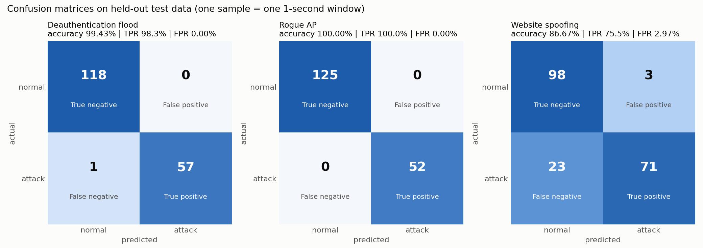
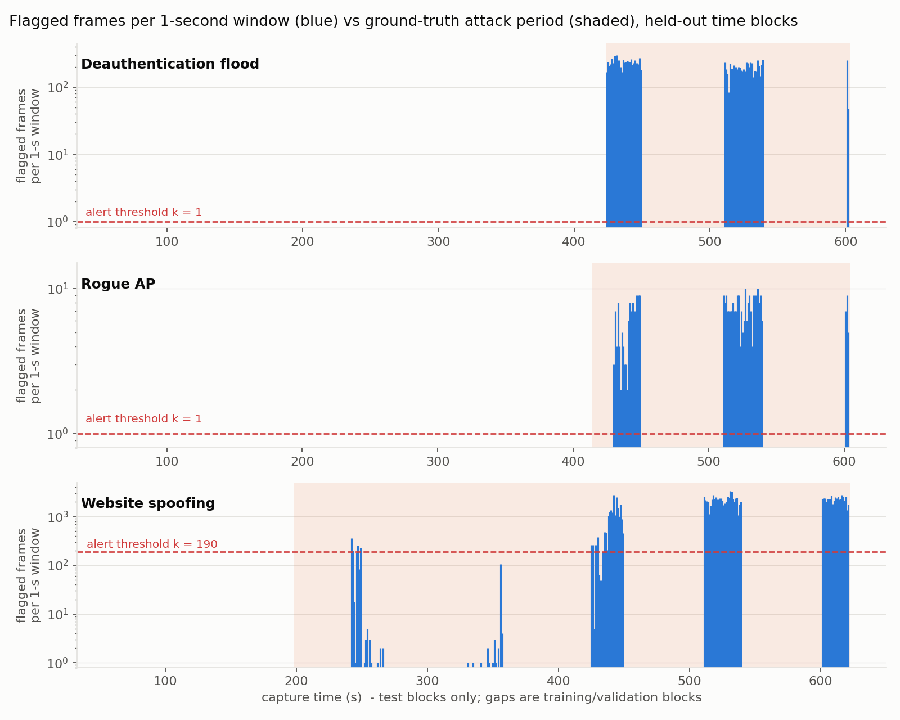

# WIDS: Machine-learning Wireless Intrusion Detection System

A working prototype of a Wireless Intrusion Detection System (WIDS). It reads 802.11 frames,
learns what normal traffic looks like on the network, scores every frame with a scikit-learn
classifier and **raises an alert when a deauthentication flood starts**. The same pipeline is
also trained for two further attacks (rogue access point and website spoofing).

This is a detection-only system (WIDS, not WIPS): it alerts and logs, and never transmits.

---

## Results

Tested on held-out time blocks that the model never saw during training.
**One sample = one 1-second window**; the window raises an alert when the model flags its frames.

### Deauthentication flood (the required attack)

|                   | Predicted normal | Predicted attack |
|-------------------|-----------------:|-----------------:|
| **Actual normal** | 118 (TN)         | 0 (FP)           |
| **Actual attack** | 1 (FN)           | 57 (TP)          |

| Accuracy | Attack seconds caught (TPR) | False alarm rate (FPR) | Precision |
|---------:|----------------------------:|-----------------------:|----------:|
| 99.43%   | 98.3%                       | 0.0%                   | 100%      |

The only missed second (423 s) contains just the first 0.15 s of the flood, so the alert fires
about one second after the attack begins.

Accuracy alone is misleading here: a model that always answered "normal" would still score 67%
while catching nothing. That is why TPR, FPR and precision are reported as well.

### All three detectors (per 1-second window)

| Attack                 | TP | FP | TN  | FN | Accuracy | TPR   | FPR  | Precision |
|------------------------|---:|---:|----:|---:|---------:|------:|-----:|----------:|
| Deauthentication flood | 57 | 0  | 118 | 1  | 99.43%   | 98.3% | 0.0% | 100%      |
| Rogue AP               | 52 | 0  | 125 | 0  | 100%     | 100%  | 0.0% | 100%      |
| Website spoofing       | 71 | 3  | 98  | 23 | 86.67%   | 75.5% | 3.0% | 95.9%     |

Caveat: the rogue-AP detector leans on beacon frame length (the rogue AP's beacons are always
263 bytes, the real ones 342). Without that feature its frame-level recall drops to 42.7%.




---

## How it works

**Baseline → Observe → Features → Classify → Alert → Validate**

1. **Baseline.** The first 90 seconds of the capture are attack-free. The sensor learns this
   network's normal behaviour from them, for example "at most 3 deauthentication frames per second".
2. **Observe.** Frames are read in the order they were captured.
3. **Features** for every frame:
   - **Frame type and subtype**: is it a deauthentication (subtype 12) or disassociation frame?
   - **Signal strength (dBm)**: the attacker's radio sat at about −42 dBm, the real access points at −36 and −57 dBm.
   - **Frames per second**: deauths in the last second compared with the baseline maximum, plus total frames, beacons and retries.
   - **Unusual for this network**: frame lengths and signal levels never seen in the baseline.
4. **Classify.** A gradient-boosted decision-tree model (scikit-learn
   `HistGradientBoostingClassifier`, 200 trees, class-balanced because attacks are rare) gives
   each frame a score from 0 to 1.
5. **Alert.** A 1-second window raises an alert when at least *k* frames are flagged, with *k*
   chosen as the smallest value that gives no false alarms on clean validation data
   (k = 1 for deauth). Every alert second is written to `alerts.log`.
6. **Validate.** The capture is cut into 30-second blocks: one third for training, one third for
   tuning the thresholds and one third for testing. Test seconds are never used in training.

Two traps in the supplied data were avoided on purpose:
- The time columns are **not** used as features. Each attack starts at a fixed time, so a model
  given only the clock reaches 93–99% recall without looking at the frames at all.
- The supplied `*_train.csv` / `*_test.csv` files are a random split of the same capture, and
  77–88% of the test rows also appear in the training file. They were re-joined and split by time instead.

---

## Getting started

### 1. Requirements
Python 3.10 or newer and about 8 GB of free RAM.

```powershell
py -m pip install pandas numpy scikit-learn matplotlib joblib pyarrow
```
(On macOS or Linux use `python3 -m pip ...` and `python3` instead of `py` below.)

### 2. Data
The dataset is **not** included in this repository: the files are too large for GitHub
(three exceed its 100 MB limit), and the dataset should be obtained from its source.

This project uses an extract of the **AWID3** 802.11 dataset (University of the Aegean).
Place the six CSV files in a folder called `data/` inside the project:

```
data/
├── deauth_train.csv
├── deauth_test.csv
├── rogue_ap_train.csv
├── rogue_ap_test.csv
├── website_spoofing_train.csv
└── website_spoofing_test.csv
```

### 3. Run the live alert demo
The trained detectors are already in `results/`, so the demo works straight away:

```powershell
py detect.py
```

It replays the deauth capture second by second from 380 s at 10x speed. Normal seconds scroll
past in green; at 424 s a red **ALERT: DEAUTHENTICATION FLOOD DETECTED** appears, and each
alert second is written to `alerts.log`.

| Command | What it does |
|---|---|
| `py detect.py` | Live demo from 380 s at 10x speed |
| `py detect.py --speed 2` | Slower, easier to narrate |
| `py detect.py --held-out --start 0 --speed 50` | Only unseen test seconds; ends with the confusion matrix and accuracy |
| `py detect.py --attack rogue_ap` | Run the rogue-AP detector instead |
| `py detect.py --csv my_frames.csv` | Replay any CSV with the same columns (the `Label` column is optional) |

### 4. Train and test from scratch

```powershell
py wids.py --data data --out results
```
Takes about 10 minutes and prints the confusion-matrix numbers for every attack. The random
seed is fixed at 42, so you get exactly the numbers above.

If `results/` already contains saved results, the script reuses them and just prints the
summary. To retrain, delete the `results` folder first (`Remove-Item -Recurse results`).

### 5. Figures

```powershell
py figures.py --data data --out results
```
Writes the confusion matrices, timeline, feature-importance chart and poster figures to `results/`.

---

## Files

| File | Purpose |
|---|---|
| `wids.py` | Full pipeline: load → baseline → features → train → alert → evaluate |
| `detect.py` | Live-replay demo: alerts on screen and in `alerts.log` |
| `figures.py` | Confusion matrices, timeline, feature importance, poster figures |
| `pipeline.mmd` | Source of the pipeline diagram (Mermaid) |
| `results/<attack>_detector.joblib` | Trained model, frame threshold and alert threshold *k* |
| `results/results.json` | Every metric, including the leakage checks and ablations |
| `results/<attack>_windows.csv` | Per-second flagged-frame counts and ground truth |
| `results/fig_*.png`, `results/poster_*.png` | Figures |

---

## Limitations and what I would improve

- **Per-device rates.** The dataset has no MAC addresses, so frames are counted per channel, not
  per device. With MACs the system could also log the offending device (a step towards a WIPS).
- **Live traffic.** The prototype replays recorded frames; next step is reading monitor-mode
  traffic live in an authorised lab.
- **Slow attacks.** A flood slower than the baseline maximum (3 deauths per second) or the quiet
  phases of website spoofing can slip under the alert line. A longer baseline that includes busy
  periods would help.
- **Rogue AP identity.** Detection relies on beacon length, which an attacker can copy. Checking
  BSSID and security settings against an inventory of authorised access points would be stronger.
- **Prevention.** Detection is not prevention: enabling 802.11w Protected Management Frames
  makes forged deauthentication frames useless.

---

## Ethics

Offline analysis of the AWID3 dataset only: no traffic was captured, no attacks were generated
and nothing was transmitted. The system only detects and logs; it performs no automatic
counter-deauthentication, which could be unlawful under the Kenya Information and Communications
Act and the Computer Misuse and Cybercrimes Act.

## Use of AI

I used Claude (Anthropic) to help write the Python code, run the experiments and lay out the
poster. I ran and tested all the code on my own laptop and checked that every result matched.
I can explain how each part of the system works.
